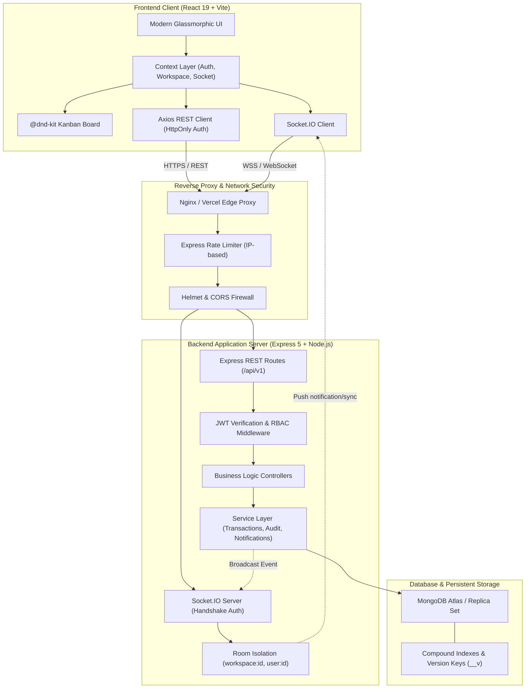
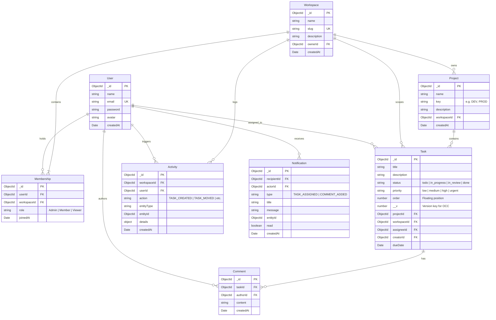

# 🚀 DevCollab — Enterprise Collaborative Project & Task Management Platform

[](https://devcollab-ten-black.vercel.app)
[](https://devcollab-8zpg.onrender.com/api/health)
[](https://github.com/imayush1304/devcollab)
[](https://github.com/imayush1304/devcollab)
[](https://github.com/imayush1304/devcollab)
[](LICENSE)

> A modern, real-time, multi-tenant project management SaaS inspired by **Linear**, **Jira**, and **Trello**. Built with high-throughput Express 5, React 19, MongoDB Atlas, and bidirectional Socket.IO WebSockets. Engineered with zero-trust RBAC, Optimistic Concurrency Control (OCC), glassmorphic design, and 80+ automated tests.

---

### 🌐 Live Production Deployment

| Service | Live URL | Hosting |
|---|---|---|
| **Frontend Web App** | **[https://devcollab-ten-black.vercel.app](https://devcollab-ten-black.vercel.app)** | Vercel (Global Edge Network) |
| **Backend REST & WebSockets** | **[https://devcollab-8zpg.onrender.com](https://devcollab-8zpg.onrender.com)** | Render (Node.js Cloud Service) |
| **API Health Diagnostics** | **[https://devcollab-8zpg.onrender.com/api/health](https://devcollab-8zpg.onrender.com/api/health)** | Live Atlas Connected |

#### 🔑 One-Click Recruiter Demo Logins:
The live login screen includes one-click instant login buttons with zero typing required:
- 👑 **Admin**: `ayush@example.com` / `Password123!` *(Full workspace, project, and RBAC control)*
- 💻 **Member**: `sarah.dev@example.com` / `Password123!` *(Kanban drag-and-drop, task creation, comments)*
- 👁️ **Viewer**: `alex.viewer@example.com` / `Password123!` *(Read-only board and activity feed)*

---

## 📑 Table of Contents
1. [System Architecture](#-system-architecture)
2. [Database Schema & ER Diagram](#-database-schema--er-diagram)
3. [Core Technical Innovations](#-core-technical-innovations)
4. [Tech Stack](#-tech-stack)
5. [API Specification](#-api-specification)
6. [Security & RBAC Architecture](#-security--rbac-architecture)
7. [Getting Started & Local Setup](#-getting-started--local-setup)
8. [Docker Containerization](#-docker-containerization)
9. [Automated Testing Suite](#-automated-testing-suite)
10. [Engineering Interview Q&A Guide](#-engineering-interview-qa-guide)

---

## 🏛 System Architecture

The DevCollab platform employs a decoupled client-server architecture with dual transport layers: **stateless REST** for CRUD transactions and **stateful WebSockets** for low-latency real-time state synchronization.



---

## 🗄 Database Schema & ER Diagram

The database utilizes MongoDB with strict document schema enforcement via Mongoose, compound index optimization, and versioning for concurrency control.



---

## ⚡ Core Technical Innovations

### 1. Optimistic Concurrency Control (OCC)
In high-velocity collaborative environments, simultaneous Kanban drag-and-drop operations can overwrite colleague updates (lost update anomaly).
- **Solution**: Every `Task` document carries a version field (`__v`).
- When updating task status or order, the request specifies the expected current version:
  ```javascript
  const task = await Task.findOneAndUpdate(
    { _id: taskId, __v: expectedVersion },
    { $set: updates, $inc: { __v: 1 } },
    { new: true }
  );
  if (!task) throw new ConflictError("Task was modified by another user. Reloading...");
  ```
- If another user updated the card in the interim, the update yields `409 Conflict`, prompting an instant reload to safeguard data integrity.

### 2. Multi-Tenant Room Isolation in WebSockets
- Socket.IO connection is authenticated during the WebSocket upgrade handshake using JWT cookies.
- Socket clients only join authorized rooms based on their verified workspace memberships:
  ```javascript
  socket.join(`workspace:${workspaceId}`);
  socket.join(`user:${userId}`);
  ```
- Broadcasts (`task:created`, `task:updated`, `comment:added`) are scoped exclusively to `workspace:${workspaceId}`, guaranteeing zero cross-tenant event leakage.

### 3. High-Performance Drag-and-Drop
- Built using `@dnd-kit/core` and `@dnd-kit/sortable`.
- Implements **Optimistic UI Updates**: The card visually snaps to the target column immediately. If the network request fails, state rolls back automatically with user feedback.

---

## 🛠 Tech Stack

| Domain | Technologies |
|---|---|
| **Frontend** | React 19, Vite, `@dnd-kit`, Vanilla CSS (Custom Design System), Lucide Icons, Axios, Socket.IO Client |
| **Backend** | Node.js, Express 5, Socket.IO, Mongoose 8, Bcrypt (12 rounds), JsonWebToken, Express Rate Limit, Helmet |
| **Database** | MongoDB Atlas (Cloud Replica Set), Compound & Unique Indexes |
| **DevOps** | Docker, Multi-Stage Builds, Nginx Reverse Proxy, Docker Compose, Vercel (SPA), Render |
| **Testing** | Jest, Supertest, In-Memory Mongo Memory Server, Live Atlas Smoke Runner |

---

## 📡 API Specification

All protected endpoints require a valid JWT Bearer token or HttpOnly cookie.

### Authentication (`/api/v1/auth`)
| Method | Endpoint | Description | Access |
|---|---|---|---|
| `POST` | `/register` | Register new user account | Public |
| `POST` | `/login` | Authenticate and issue JWT | Public |
| `POST` | `/logout` | Revoke session and clear cookies | Protected |
| `GET` | `/me` | Retrieve authenticated user profile | Protected |

### Workspaces (`/api/v1/workspaces`)
| Method | Endpoint | Description | RBAC |
|---|---|---|---|
| `GET` | `/` | List all workspaces user is member of | Authenticated |
| `POST` | `/` | Create new workspace (creator becomes Admin) | Authenticated |
| `GET` | `/:id` | Get workspace details and metrics | Viewer+ |
| `POST` | `/:id/members` | Invite new member with designated role | Admin |
| `DELETE` | `/:id/members/:userId` | Remove member from workspace | Admin |

### Projects & Tasks (`/api/v1/projects`, `/api/v1/tasks`)
| Method | Endpoint | Description | RBAC |
|---|---|---|---|
| `GET` | `/workspaces/:workspaceId/projects` | List projects in workspace | Viewer+ |
| `POST` | `/workspaces/:workspaceId/projects` | Create a new project | Member+ |
| `GET` | `/projects/:projectId/tasks` | Fetch Kanban tasks with filtering | Viewer+ |
| `POST` | `/projects/:projectId/tasks` | Create task with assignee & priority | Member+ |
| `PATCH` | `/tasks/:id` | Update task status, order, or fields (OCC) | Member+ |
| `DELETE` | `/tasks/:id` | Delete task | Admin / Creator |

### Notifications & Comments (`/api/v1/notifications`, `/api/v1/comments`)
| Method | Endpoint | Description | Access |
|---|---|---|---|
| `GET` | `/notifications` | Get user notifications (All/Unread) | Protected |
| `PATCH` | `/notifications/:id/read` | Mark individual notification read | Protected |
| `PATCH` | `/notifications/read-all` | Mark all notifications read | Protected |
| `GET` | `/tasks/:taskId/comments` | Fetch threaded comments on task | Viewer+ |
| `POST` | `/tasks/:taskId/comments` | Add comment & notify assignee | Member+ |

### Real-Time Messaging & Conversations (`/api/conversations`)
| Method | Endpoint | Description | Access |
|---|---|---|---|
| `GET` | `/` | List conversations for user in workspace (with unread counts) | Workspace Member |
| `POST` | `/direct` | Find or concurrency-safely create direct conversation | Workspace Member |
| `GET` | `/project/:projectId` | Find or auto-provision project channel | Workspace Member |
| `GET` | `/:id` | Get conversation details and participants | Participant / Member |
| `GET` | `/:id/messages` | Cursor-based paginated message history (`?cursor=&limit=`) | Participant / Member |
| `POST` | `/:id/messages` | Send message (REST fallback & persistence) | Participant / Member |
| `POST` | `/:id/read` | Mark conversation as read and reset unread count | Participant / Member |
| `GET` | `/:id/unread-count` | Get unread message count for conversation | Participant / Member |

---

## ⚡ Phase 2: Real-Time Messaging & Presence Architecture

DevCollab Phase 2 introduces a high-throughput, modular monolithic real-time messaging engine built directly into the unified backend and frontend without external microservices or Redis dependencies.

### 1. Conversation Types & Partitioning
- **Project Channels (`PROJECT`)**: Automatically mapped 1-to-1 to workspace projects. Any authorized workspace member can join and collaborate in project channel discussions.
- **Direct Messages (`DIRECT`)**: Secure 1-to-1 private messaging between eligible workspace members. Enforced by unique compound indexes preventing duplicate direct conversations under high-concurrency race conditions.

### 2. Socket.IO Real-Time Event Contract

#### Client-to-Server Events:
- `conversation:join` (`{ conversationId }`): Authenticates socket, verifies workspace and participant authorization, joins room `conversation:<id>`.
- `conversation:leave` (`{ conversationId }`): Unsubscribes socket from conversation room.
- `message:send` (`{ conversationId, content, tempId }`): Validates content, derives sender identity from verified JWT, persists to MongoDB, updates conversation `lastMessageAt`, and broadcasts to other room participants. Acknowledges sender with `{ success: true, message, tempId }`.
- `conversation:read` (`{ conversationId }`): Upserts `ConversationReadState` and updates unread badge across user's active devices.

#### Server-to-Client Events:
- `message:new` (`message`): Broadcasts new message to conversation room (excluding sender to prevent duplicate echo).
- `conversation:updated` (`{ conversationId, lastMessageAt, lastMessage }`): Broadcasts snippet update to workspace room for real-time sidebar ordering.
- `conversation:unread-updated` (`{ conversationId, unreadCount }`): Syncs unread counters.
- `presence:updated` (`{ userId, status: 'online' | 'offline' }`): Broadcasts user status transitions within workspace rooms.

### 3. Ephemeral Multi-Connection Presence Tracking
- Tracks multiple active socket connections per user across separate tabs/devices in an in-memory registry (`Map<userId, Set<socketId>>`).
- Closing one tab leaves the user marked **Online** as long as another tab remains open.
- Cleans up state immediately upon complete disconnection and broadcasts status only within authorized workspace boundaries.
- **Architectural Note**: This single-instance design maintains ultra-fast in-memory lookups with zero operational cost. In a multi-node horizontal deployment, a Redis adapter (`@socket.io/redis-adapter`) would be introduced for distributed socket pub/sub.

---

## 🔒 Security & RBAC Architecture

DevCollab enforces a **Zero-Trust Role-Based Access Control** system at both middleware and service boundaries:

```
┌─────────────────────────────────────────────────────────────┐
│                    Role Hierarchy                           │
├─────────────┬───────────────────────────────────────────────┤
│ Admin       │ Workspace deletion, billing, member invites,  │
│             │ role demotion/promotion, task deletion        │
├─────────────┼───────────────────────────────────────────────┤
│ Member      │ Project creation, task creation, editing,     │
│             │ status drag-and-drop, commenting              │
├─────────────┼───────────────────────────────────────────────┤
│ Viewer      │ Read-only visibility: view board, inspect     │
│             │ task cards, read comments & activity history  │
└─────────────┴───────────────────────────────────────────────┘
```

**Security Defenses:**
1. **Password Security**: Bcrypt with 12 salt rounds.
2. **XSS Protection**: Sanitization, React automatic JSX escaping, HttpOnly session cookies.
3. **CSRF Mitigation**: SameSite cookie flag paired with custom header authorization.
4. **Brute-Force Shield**: Express Rate Limiter with 300 requests/15 min limit (configurable in dev).
5. **Data Protection**: MongoDB object ID parameter pollution validation using custom validators.

---

## 🚀 Getting Started & Local Setup

### Prerequisites
- **Node.js** >= 18.0.0
- **MongoDB** (local daemon or free MongoDB Atlas URI)
- **Git**

### 1. Clone the repository
```bash
git clone https://github.com/imayush1304/devcollab.git
cd devcollab
```

### 2. Configure Environment Variables
Create `.env` in `server/`:
```env
PORT=5000
NODE_ENV=development
CLIENT_URL=http://localhost:5173
MONGODB_URI=mongodb+srv://<user>:<password>@cluster0.mongodb.net/devcollab
JWT_SECRET=super_secret_jwt_key_min_32_characters_long
JWT_EXPIRES_IN=7d
```

Create `.env` in `client/`:
```env
VITE_API_URL=http://localhost:5000/api/v1
VITE_SOCKET_URL=http://localhost:5000
```

### 3. Install & Run
```bash
# Install server dependencies
cd server
npm install

# Seed demo users & sample projects
npm run seed

# Run server (runs on http://localhost:5000)
npm run dev

# In a new terminal, run client:
cd ../client
npm install
npm run dev
# Opens at http://localhost:5173
```

---

## 🐳 Docker Containerization

Run the entire production stack (Frontend Nginx, Node.js Backend, and MongoDB) with a single command:

```bash
docker-compose up --build -d
```
- Client accessible at `http://localhost:80`
- API Backend accessible at `http://localhost:5000`
- Database runs on isolated internal Docker bridge network.

---

## 🧪 Automated Testing Suite

The codebase features an exhaustive **93-test automated suite** covering unit, integration, edge cases, real-time WebSockets, and concurrency:

```bash
cd server
npm test
```

### Test Suite Breakdown:
- `health.test.js`: Server liveness and system diagnostics (3 tests)
- `auth.test.js`: Registration, login, JWT issuance, password hashing (12 tests)
- `workspace.test.js`: Multi-tenancy, member invitation, slug generation (10 tests)
- `project_task.test.js`: Project hierarchy, task lifecycle, priority sorting (10 tests)
- `comment_activity.test.js`: Audit trail, real-time comment authoring (14 tests)
- `socket.test.js`: WebSocket handshake, room isolation, task/comment broadcasts (6 tests)
- `notification.test.js`: In-app notification creation, unread count, read-all (9 tests)
- `edge_cases.test.js`: Concurrency conflicts, duplicate slugs, invalid IDs, RBAC escalation attempts (16 tests)
- `conversation.test.js`: Phase 2 messaging REST endpoints, cursor pagination, duplicate DM prevention under concurrency, unread counts (8 tests)
- `messaging_socket.test.js`: Phase 2 real-time messaging, room authorization, non-echo broadcast, multi-connection presence tracking, reconnection message loading (5 tests)

---

## 🎯 Engineering Interview Q&A Guide

When discussing this project with engineering leaders at Tier-1 product companies, reference these architectural design choices:

<details>
<summary><b>1. How do you prevent race conditions when two users drag the same task at the same time?</b></summary>
<br>
We implement <b>Optimistic Concurrency Control (OCC)</b> using Mongoose versioning (<code>__v</code>). Each status or order update includes the document's current version in the atomic query criteria (<code>findOneAndUpdate({ _id, __v: expectedVersion }, { $set: ..., $inc: { __v: 1 } })</code>). If a simultaneous write occurred, the version mismatch returns <code>null</code>, and the backend throws a <code>409 Conflict</code>. The client catches this, displays an informative toast, and refreshes the task state from the server.
</details>

<details>
<summary><b>2. How does real-time collaboration scale without leaking data across tenants?</b></summary>
<br>
Socket.IO relies on <b>Room Isolation</b>. Upon establishing a connection, the handshake middleware verifies the user's JWT. The socket only subscribes to rooms the user belongs to (<code>workspace:&lt;id&gt;</code> and <code>user:&lt;id&gt;</code>). When tasks or comments are created, events are emitted exclusively to the specific workspace room. Users in other workspaces never receive or see the events.
</details>

<details>
<summary><b>3. Why did you use HttpOnly cookies combined with Bearer tokens?</b></summary>
<br>
Storing JWTs in <code>localStorage</code> exposes tokens to Cross-Site Scripting (XSS) attacks. By using <code>HttpOnly</code>, <code>SameSite=Lax</code> (or <code>None</code> with <code>Secure</code> in cross-origin production), scripts cannot access the token. We also support standard <code>Authorization: Bearer</code> headers so mobile clients and external integrations can authenticate statelessly.
</details>

<details>
<summary><b>4. How is database performance optimized for high-volume Kanban boards?</b></summary>
<br>
We established compound indexes on high-frequency query patterns:
1. <code>{ projectId: 1, status: 1, order: 1 }</code> for instantaneous board column loading.
2. <code>{ workspaceId: 1, createdAt: -1 }</code> for rapid activity log timeline rendering.
3. <code>{ recipientId: 1, read: 1, createdAt: -1 }</code> for zero-latency notification bell indicators.
</details>

---

## 👤 Author
**Ayush Anand**
- GitHub: [@imayush1304](https://github.com/imayush1304)
- Email: ayushanand2k6@gmail.com

---
*Built with passion for high-performance software engineering.*
